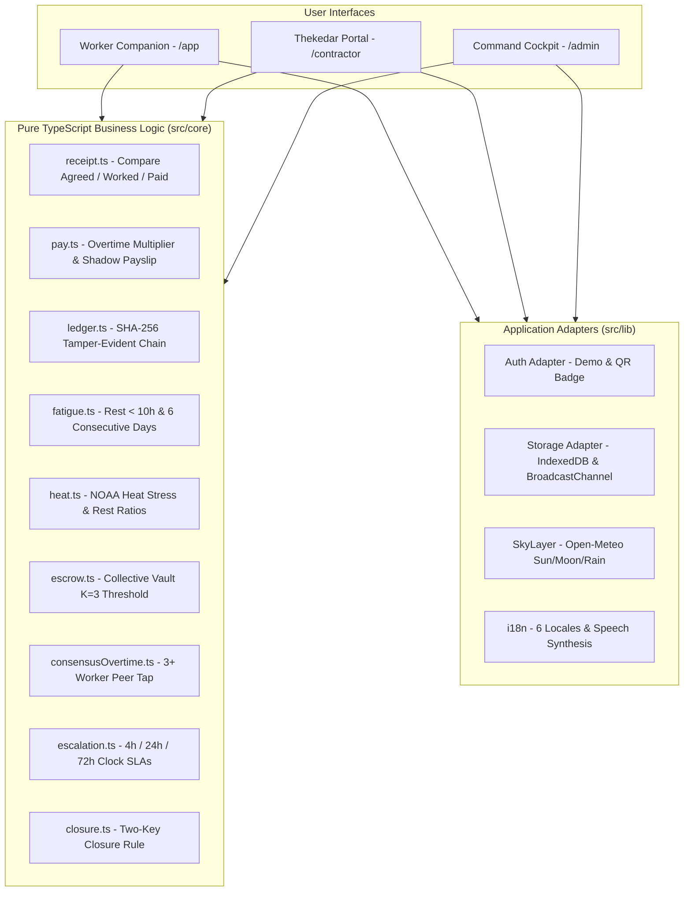

# FairShift Hisaab (फेयरशिफ्ट हिसाब)

> **Workplace Fairness Platform for UN SDG 8 (Decent Work and Economic Growth)**  
> Built with Next.js 15 App Router, TypeScript (Strict), Tailwind CSS, Zod, and Vitest. Designed for Google Cloud Run deployment.

---

## 1. Problem
Across campus facility services, construction sites, and manufacturing sectors, millions of outsourced and contractual workers experience systemic vulnerabilities:
- **Unlogged Overtime & Wage Mismatch**: Worked hours differ from muster roll payments without clear recourse.
- **Unaddressed Worksite Hazards**: Safety hazards reported to supervisors linger unresolved, causing acute injuries.
- **Fear of Retaliation**: Individual workers hesitate to report supervisor misconduct, arbitrary wage deductions, or safety breaches due to fear of termination.
- **Lack of Verified Proof**: Displaced or contract laborers lack tamper-evident proof of service or statutory entitlements.

---

## 2. What We Built
**FairShift Hisaab** is an enterprise-grade workplace fairness and compliance ecosystem anchored in the **"Two-Key Rule"**:
*No pay mismatch, hazard, or complaint is marked resolved unless the worker confirms it OR independent proof exists.*

The platform delivers two distinct, configuration-driven interfaces:
1. **Worker Companion**: A mobile-first Progressive Web App (PWA) with 5 accessible tabs (Home, Money, Safety, Speak Up, Rights), 72px check-in actions, Money Jar wage visualization, and complete local language audio readout.
2. **Employer Command Cockpit**: A desktop-first administrative cockpit with UN SDG 8 impact telemetry, statutory SLA clock monitors, consensus overtime detection, thekedar scorecards, and one-tap inspection pack downloads.

---

## 3. Problem Statement Alignment

| Requirement | Implementation File(s) | Description |
| :--- | :--- | :--- |
| **Shift Tracking** | [`src/core/ledger.ts`](file:///C:/Users/vaibh/.gemini/antigravity/scratch/fairshift-hisaab/src/core/ledger.ts)<br>[`src/app/app/page.tsx`](file:///C:/Users/vaibh/.gemini/antigravity/scratch/fairshift-hisaab/src/app/app/page.tsx) | Coarse-location shift check-in linked to a cryptographic SHA-256 tamper-evident hash chain. |
| **Clear Payslips & Gap Explanation** | [`src/core/pay.ts`](file:///C:/Users/vaibh/.gemini/antigravity/scratch/fairshift-hisaab/src/core/pay.ts)<br>[`src/core/receipt.ts`](file:///C:/Users/vaibh/.gemini/antigravity/scratch/fairshift-hisaab/src/core/receipt.ts)<br>[`src/app/app/money/page.tsx`](file:///C:/Users/vaibh/.gemini/antigravity/scratch/fairshift-hisaab/src/app/app/money/page.tsx) | 3-row Work Receipts (Agreed, Worked, Paid), visual SVG Money Jar, and shadow payslip explaining wage gaps. |
| **Safety Reporting & Two-Key Closure** | [`src/core/closure.ts`](file:///C:/Users/vaibh/.gemini/antigravity/scratch/fairshift-hisaab/src/core/closure.ts)<br>[`src/core/escalation.ts`](file:///C:/Users/vaibh/.gemini/antigravity/scratch/fairshift-hisaab/src/core/escalation.ts)<br>[`src/app/app/safety/page.tsx`](file:///C:/Users/vaibh/.gemini/antigravity/scratch/fairshift-hisaab/src/app/app/safety/page.tsx) | 3-step hazard reporting, statutory SLA clock (4h, 24h, 72h), and mandatory After-photo + worker confirmation closure loop. |
| **Honest Feedback & Anonymous Vault** | [`src/core/escrow.ts`](file:///C:/Users/vaibh/.gemini/antigravity/scratch/fairshift-hisaab/src/core/escrow.ts)<br>[`src/app/app/speak-up/page.tsx`](file:///C:/Users/vaibh/.gemini/antigravity/scratch/fairshift-hisaab/src/app/app/speak-up/page.tsx)<br>[`src/app/api/ai/transcribe-scrub/route.ts`](file:///C:/Users/vaibh/.gemini/antigravity/scratch/fairshift-hisaab/src/app/api/ai/transcribe-scrub/route.ts) | Collective Escrow vault: reports stay sealed until K=3 distinct workers report the same target. Urgent safety risks bypass escrow. |
| **Skill Passport** | [`src/app/app/page.tsx`](file:///C:/Users/vaibh/.gemini/antigravity/scratch/fairshift-hisaab/src/app/app/page.tsx) | Safe work hours progress bar tracking milestones toward certification. |
| **Fatigue & Heat Alerts** | [`src/core/fatigue.ts`](file:///C:/Users/vaibh/.gemini/antigravity/scratch/fairshift-hisaab/src/core/fatigue.ts)<br>[`src/core/heat.ts`](file:///C:/Users/vaibh/.gemini/antigravity/scratch/fairshift-hisaab/src/core/heat.ts) | Pure logic flagging rest intervals &lt; 10h, &ge; 6 consecutive days, and NOAA heat stress work-rest ratios. |
| **Admin Command Cockpit** | [`src/app/admin/page.tsx`](file:///C:/Users/vaibh/.gemini/antigravity/scratch/fairshift-hisaab/src/app/admin/page.tsx)<br>[`src/app/contractor/page.tsx`](file:///C:/Users/vaibh/.gemini/antigravity/scratch/fairshift-hisaab/src/app/contractor/page.tsx) | Desktop-first cockpit: Decent Work Index, pay correction queue, contractor scorecards, burnout radar. |
| **Voice & 6 Local Languages** | [`src/lib/i18n/context.tsx`](file:///C:/Users/vaibh/.gemini/antigravity/scratch/fairshift-hisaab/src/lib/i18n/context.tsx)<br>[`messages/*.json`](file:///C:/Users/vaibh/.gemini/antigravity/scratch/fairshift-hisaab/messages/en.json)<br>[`src/components/ui/ReadAloudButton.tsx`](file:///C:/Users/vaibh/.gemini/antigravity/scratch/fairshift-hisaab/src/components/ui/ReadAloudButton.tsx) | Complete localization in English, Hindi, Bangla, Tamil, Punjabi, and Urdu (RTL). Text-to-speech on every screen. |
| **Two Interfaces** | Mobile Worker Companion (`/app`) and Desktop Command Cockpit (`/admin`) | Mobile-first bottom navigation with 64px touch targets; desktop sidebar cockpit with statutory export registers. |
| **2+ Industries via Config** | [`src/config/sectors.ts`](file:///C:/Users/vaibh/.gemini/antigravity/scratch/fairshift-hisaab/src/config/sectors.ts)<br>[`src/config/roles.ts`](file:///C:/Users/vaibh/.gemini/antigravity/scratch/fairshift-hisaab/src/config/roles.ts) | SRMIST Campus Facility & Hostel Staff, Metro Rail Construction, District General Hospital. |

---

## 4. Architecture



---

## 5. Security Notes
- **Zero Secrets in Repository**: No private credentials, API keys, or database secrets are committed. Everything is read from `process.env`.
- **Signed 8-Hour Session Cookies**: Authenticated sessions use cryptographically signed JWTs (`HS256` via `jose`) stored in `httpOnly`, `sameSite=lax`, secure cookies.
- **Client-Side EXIF Metadata Stripping**: Hazard photos are drawn onto a canvas and re-encoded in the client browser to strip GPS, device identifiers, and metadata before transmission.
- **K-Anonymity & Differential Privacy**: Collective Escrow suppresses group counts below $K=3$ so no administrator or contractor can infer identity from individual report spikes.

---

## 6. Accessibility Notes (WCAG AA Compliant)
- **Contrast Ratios**: Verified programmatically in unit tests (`tests/core/contrast.test.ts`). Worker body text exceeds 7:1 in the default Obsidian theme, and all interactive text exceeds 4.5:1.
- **Keyboard Navigation & Focus Management**: Full keyboard flow with visible focus rings (`focus-visible:ring-4 focus-visible:ring-lime`) and a skip-to-content link.
- **Screen Reader Support**: ARIA live regions for toasts (`aria-live="polite"`), modal dialogs with focus trap and Escape key dismissal.
- **Urdu Right-to-Left Layout**: Dynamically mirrors layout with CSS logical properties (`margin-inline-start`, `start-0`).
- **Touch Targets**: All worker buttons and navigation tiles adhere to a minimum of 48px to 72px.

---

## 7. Limitations & Disclaimers
1. **Simulated Seed Data**: Persona Sunita Devi, Balaji Facility Services, and associated records are fictional simulations designed for demonstration purposes.
2. **Tamper-Evident Ledger**: The hash-chained shift ledger is cryptographic and **tamper-evident** (detects any modified record instantly), but not tamper-proof against full chain replacement unless anchored to a public decentralized timestamp.
3. **AI Verdicts are Advisory Only**: Gemini Vision comparisons provide automated guidance for site auditors but cannot unilaterally close tickets. The human **Two-Key Rule** remains mandatory.
4. **General Information**: Content provided in the Rights tab is general educational guidance and does not constitute formal legal counsel. Helplines should be verified prior to local deployment.

---

## 8. Run and Test Locally

```bash
# 1. Install dependencies
npm install --legacy-peer-deps

# 2. Run unit and accessibility test suite
npm run test

# 3. Build standalone production output
npm run build

# 4. Launch local development server
npm run dev
```

---

## 9. Deployment to Google Cloud Run

FairShift Hisaab is built with `output: "standalone"` and a multi-stage Dockerfile optimized for Google Cloud Run:

```bash
# Build and deploy directly to Cloud Run
gcloud run deploy fairshift \
  --source . \
  --region asia-south1 \
  --allow-unauthenticated \
  --set-env-vars DEMO_MODE=true \
  --set-secrets SESSION_SECRET=session-secret:latest
```

*Note: The Cloud Run service account should be granted the Vertex AI User role (`roles/aiplatform.user`) for zero-API-key Gemini operation.*
