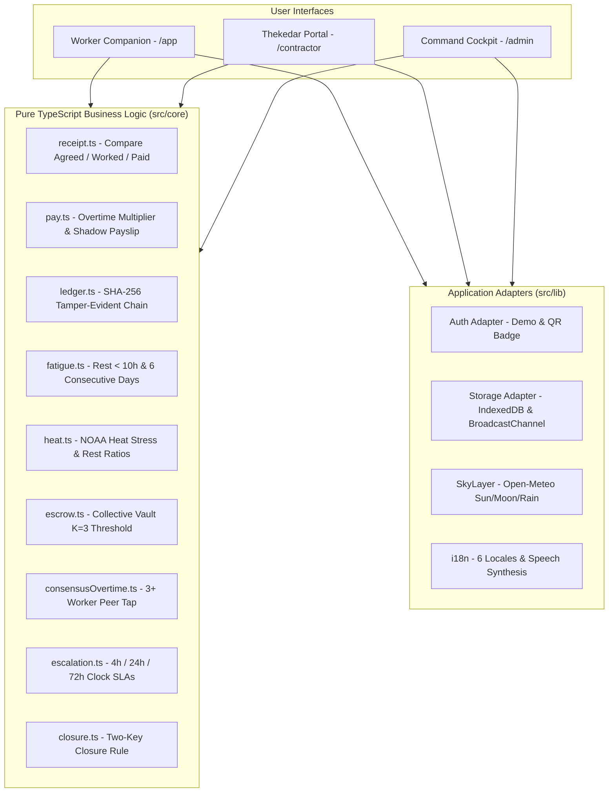

# FairShift Hisaab (फेयरशिफ्ट हिसाब)

> **Workplace Fairness Platform for UN SDG 8 (Decent Work and Economic Growth)**  
> Built with Next.js 15 App Router, TypeScript (Strict), Tailwind CSS, Zod, and Vitest. Designed for Google Cloud Run deployment.

---

## 1. Chosen Vertical
**UN SDG 8: Decent Work and Economic Growth**  
- **Target 8.8**: Protect labour rights and promote safe and secure working environments for all workers, including migrant workers and those in precarious employment.
- **Target 8.5**: Achieve full and productive employment and decent work for all women and men, including equal pay for work of equal value.
- **Multi-Sector Config**: Rather than single-site hardcoded logic, the solution dynamically adapts via config files (`src/config/sectors.ts`) across 3 high-impact sectors:
  1. *SRMIST Campus Facility & Hostel Staff* (Janitorial, catering, housekeeping)
  2. *Metro Rail Construction* (Civil laborers, welders, rebar crews)
  3. *District General Hospital* (Sanitation, ward support, biomedical waste handlers)

---

## 2. Approach and Logic
FairShift Hisaab replaces unverifiable paper logs and one-sided employer discretion with mathematical and game-theoretic transparency:
- **The "Two-Key Rule"**: No pay gap, overtime discrepancy, or safety hazard ticket can ever be marked "Resolved" by a supervisor or contractor alone. It requires **Key 1** (Independent timestamped proof / after-photo) AND **Key 2** (Worker confirmation or peer consensus).
- **Collective Escrow ($K=3$)**: Solves the retaliation dilemma. Sensitive complaints (such as supervisor bribery, withheld wages, or harassment) are held in an encrypted escrow vault. The alert is only released to top-level site administrators once 3 or more distinct workers file corroborated reports against the same entity, eliminating individual exposure.
- **Consensus Overtime Detection**: When 3 or more workers tap "Still Working" within a 20-minute window outside their scheduled shift, the system programmatically flags consensus overtime on the muster roll, making unlogged overtime impossible to hide.
- **Environmental & Fatigue Intelligence**: Pure TypeScript algorithmic engines calculate NOAA Heat Index (triggering mandatory work-rest cycles) and fatigue flags (rest interval < 10h or ≥ 6 consecutive working days).
- **Tamper-Evident SHA-256 Ledger**: Every shift check-in generates a verifiable hash linked to the previous shift receipt, creating a cryptographically verifiable audit trail.

---

## 3. How the Solution Works
The system provides two synchronized, responsive interfaces connected via an offline-resilient data layer:

1. **Worker Companion (`/app`) — Mobile-First PWA**:
   - **Low-Literacy UI**: Built around an interactive visual **SVG Money Jar** (showing earned, pending, and withheld wages with no financial jargon), 72px giant touch targets, and full Web Speech API voice read-aloud in 6 languages.
   - **Check-in & Coarse Location**: Fast 1-tap shift start with coarse location verification (no invasive battery-draining continuous GPS tracking).
   - **Safety Reporting**: 3-tap hazard reporting with in-browser EXIF metadata stripping and camera downscaling for slow 2G/3G connections.
   - **Speak Up Vault**: Confidential reporting through Collective Escrow with urgent safety bypass.
   - **Know Your Rights**: Scenario-based cards with statutory wage laws and instant formal dispute letter generation.

2. **Employer Command Cockpit (`/admin`) & Contractor Muster (`/contractor`) — Desktop-First**:
   - **SDG 8 Fairness Index**: Real-time statutory compliance telemetry score across pay parity, safety resolution times, and fatigue levels.
   - **Pay Gap Resolution Queue**: Direct interface for thekedars and management to issue corrections and settlements directly to worker ledger receipts.
   - **Safety Escalation Clock**: 4-hour supervisor triage, 24-hour site safety officer SLA, and automatic 72-hour regulatory dossier escalation.
   - **One-Tap Statutory Export**: Generates inspection-ready CSV muster rolls and Form D registers for labor inspections.

---

## 4. Assumptions Made
1. **Device Access & Connectivity**: Workers may possess budget smartphones on 2G/3G connections or use shared worksite kiosks. The PWA is designed offline-first (<1 MB bundle, Service Worker caching, IndexedDB local queue, and background synchronization).
2. **Coarse vs. Invasive Geolocation**: Precise background GPS tracking violates worker privacy and drains battery. The system relies on site-level coarse coordinates verified against designated geo-zones.
3. **Escrow Threshold ($K=3$)**: $K=3$ provides statistical confidence against frivolous reports while maintaining sufficient anonymity for small crews (10–20 workers).
4. **AI Role is Strictly Advisory**: Multimodal AI (Gemini Vision and Voice Transcription) is used exclusively for unstructured data translation, transcription, and muster roll visual comparison. All money calculations, overtime rules, and closure authorizations are 100% deterministic pure TypeScript logic with zero AI hallucination risk.
5. **Multi-Language Parity**: Text strings must be 100% localized with zero hardcoded English; font weights and line heights are adjusted specifically per Indic script to ensure legibility.

---

## 3. Problem Statement Alignment

| Requirement | Implementation File(s) | Description |
| :--- | :--- | :--- |
| **Shift Tracking** | [`src/core/ledger.ts`](file:///C:/Users/vaibh/.gemini/antigravity/scratch/fairshift-hisaab/src/core/ledger.ts)<br>[`src/app/app/page.tsx`](file:///C:/Users/vaibh/.gemini/antigravity/scratch/fairshift-hisaab/src/app/app/page.tsx) | Coarse-location shift check-in linked to a cryptographic SHA-256 tamper-evident hash chain. |
| **Clear Payslips & Gap Explanation** | [`src/core/pay.ts`](file:///C:/Users/vaibh/.gemini/antigravity/scratch/fairshift-hisaab/src/core/pay.ts)<br>[`src/core/receipt.ts`](file:///C:/Users/vaibh/.gemini/antigravity/scratch/fairshift-hisaab/src/core/receipt.ts)<br>[`src/app/app/money/page.tsx`](file:///C:/Users/vaibh/.gemini/antigravity/scratch/fairshift-hisaab/src/app/app/money/page.tsx) | 3-row Work Receipts (Agreed, Worked, Paid), visual SVG Money Jar, and shadow payslip explaining wage gaps. |
| **Safety Reporting & Two-Key Closure** | [`src/core/closure.ts`](file:///C:/Users/vaibh/.gemini/antigravity/scratch/fairshift-hisaab/src/core/closure.ts)<br>[`src/core/escalation.ts`](file:///C:/Users/vaibh/.gemini/antigravity/scratch/fairshift-hisaab/src/core/escalation.ts)<br>[`src/app/app/safety/page.tsx`](file:///C:/Users/vaibh/.gemini/antigravity/scratch/fairshift-hisaab/src/app/app/safety/page.tsx) | 3-step hazard reporting, statutory SLA clock (4h, 24h, 72h), and mandatory After-photo + worker confirmation closure loop. |
| **Honest Feedback & Anonymous Vault** | [`src/core/escrow.ts`](file:///C:/Users/vaibh/.gemini/antigravity/scratch/fairshift-hisaab/src/core/escrow.ts)<br>[`src/app/app/speak-up/page.tsx`](file:///C:/Users/vaibh/.gemini/antigravity/scratch/fairshift-hisaab/src/app/app/speak-up/page.tsx)<br>[`src/app/api/ai/transcribe-scrub/route.ts`](file:///C:/Users/vaibh/.gemini/antigravity/scratch/fairshift-hisaab/src/app/api/ai/transcribe-scrub/route.ts) | Collective Escrow vault: reports stay sealed until K=3 distinct workers report the same target. Urgent safety risks bypass escrow. |
| **Skill Passport** | [`src/app/app/page.tsx`](file:///C:/Users/vaibh/.gemini/antigravity/scratch/fairshift-hisaab/src/app/app/page.tsx) | Safe work hours progress bar tracking milestones toward certification. |
| **Fatigue & Heat Alerts** | [`src/core/fatigue.ts`](file:///C:/Users/vaibh/.gemini/antigravity/scratch/fairshift-hisaab/src/core/fatigue.ts)<br>[`src/core/heat.ts`](file:///C:/Users/vaibh/.gemini/antigravity/scratch/fairshift-hisaab/src/core/heat.ts) | Pure logic flagging rest intervals &lt; 10h, &ge; 6 consecutive days, and NOAA heat stress work-rest ratios. |
| **Admin Command Cockpit** | [`src/app/admin/page.tsx`](file:///C:/Users/vaibh/.gemini/antigravity/scratch/fairshift-hisaab/src/app/admin/page.tsx)<br>[`src/app/contractor/page.tsx`](file:///C:/Users/vaibh/.gemini/antigravity/scratch/fairshift-hisaab/src/app/contractor/page.tsx) | Desktop-first cockpit: Decent Work Index, pay correction queue, contractor scorecards, burnout radar. |
| **Voice & 6 Local Languages** | [`src/lib/i18n/context.tsx`](file:///C:/Users/vaibh/.gemini/antigravity/scratch/fairshift-hisaab/src/lib/i18n/context.tsx)<br>[`messages/*.json`](file:///C:/Users/vaibh/.gemini/antigravity/scratch/fairshift-hisaab/messages/en.json)<br>[`src/components/ui/ReadAloudButton.tsx`](file:///C:/Users/vaibh/.gemini/antigravity/scratch/fairshift-hisaab/src/components/ui/ReadAloudButton.tsx) | Complete localization in English, Hindi, Bangla, Tamil, Punjabi, and Urdu (RTL). Text-to-speech on every screen. |
| **Two Interfaces** | Mobile Worker Companion (`/app`) and Desktop Command Cockpit (`/admin`) | Mobile-first bottom navigation with 64px touch targets; desktop sidebar cockpit with statutory export registers. |
| **2+ Industries via Config** | [`src/config/sectors.ts`](file:///C:/Users/vaibh/.gemini/antigravity/scratch/fairshift-hisaab/src/config/sectors.ts)<br>[`src/config/roles.ts`](file:///C:/Users/vaibh/.gemini/antigravity/scratch/fairshift-hisaab/src/config/roles.ts) | SRMIST Campus Facility & Hostel Staff, Metro Rail Construction, District General Hospital. |

---

## 4. Architecture



---

## 5. Security Notes
- **Zero Secrets in Repository**: No private credentials, API keys, or database secrets are committed. Everything is read from `process.env`.
- **Signed 8-Hour Session Cookies**: Authenticated sessions use cryptographically signed JWTs (`HS256` via `jose`) stored in `httpOnly`, `sameSite=lax`, secure cookies.
- **Client-Side EXIF Metadata Stripping**: Hazard photos are drawn onto a canvas and re-encoded in the client browser to strip GPS, device identifiers, and metadata before transmission.
- **K-Anonymity & Differential Privacy**: Collective Escrow suppresses group counts below $K=3$ so no administrator or contractor can infer identity from individual report spikes.

---

## 6. Accessibility Notes (WCAG AA Compliant)
- **Contrast Ratios**: Verified programmatically in unit tests (`tests/core/contrast.test.ts`). Worker body text exceeds 7:1 in the default Obsidian theme, and all interactive text exceeds 4.5:1.
- **Keyboard Navigation & Focus Management**: Full keyboard flow with visible focus rings (`focus-visible:ring-4 focus-visible:ring-lime`) and a skip-to-content link.
- **Screen Reader Support**: ARIA live regions for toasts (`aria-live="polite"`), modal dialogs with focus trap and Escape key dismissal.
- **Urdu Right-to-Left Layout**: Dynamically mirrors layout with CSS logical properties (`margin-inline-start`, `start-0`).
- **Touch Targets**: All worker buttons and navigation tiles adhere to a minimum of 48px to 72px.

---

## 7. Limitations & Disclaimers
1. **Simulated Seed Data**: Persona Sunita Devi, Balaji Facility Services, and associated records are fictional simulations designed for demonstration purposes.
2. **Tamper-Evident Ledger**: The hash-chained shift ledger is cryptographic and **tamper-evident** (detects any modified record instantly), but not tamper-proof against full chain replacement unless anchored to a public decentralized timestamp.
3. **AI Verdicts are Advisory Only**: Gemini Vision comparisons provide automated guidance for site auditors but cannot unilaterally close tickets. The human **Two-Key Rule** remains mandatory.
4. **General Information**: Content provided in the Rights tab is general educational guidance and does not constitute formal legal counsel. Helplines should be verified prior to local deployment.

---

## 8. Run and Test Locally

```bash
# 1. Install dependencies
npm install --legacy-peer-deps

# 2. Run unit and accessibility test suite
npm run test

# 3. Build standalone production output
npm run build

# 4. Launch local development server
npm run dev
```

---

## 9. Deployment to Google Cloud Run

FairShift Hisaab is built with `output: "standalone"` and a multi-stage Dockerfile optimized for Google Cloud Run:

```bash
# Build and deploy directly to Cloud Run
gcloud run deploy fairshift \
  --source . \
  --region asia-south1 \
  --allow-unauthenticated \
  --set-env-vars DEMO_MODE=true \
  --set-secrets SESSION_SECRET=session-secret:latest
```

*Note: The Cloud Run service account should be granted the Vertex AI User role (`roles/aiplatform.user`) for zero-API-key Gemini operation.*
